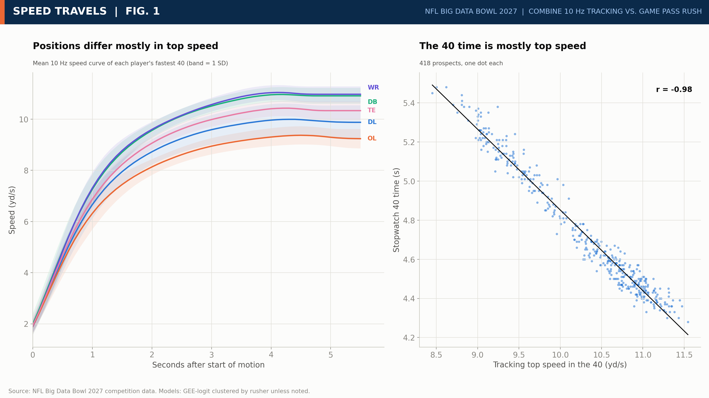
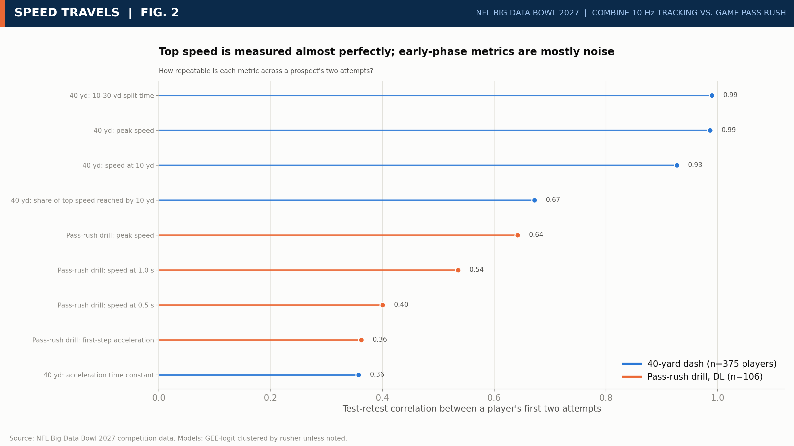
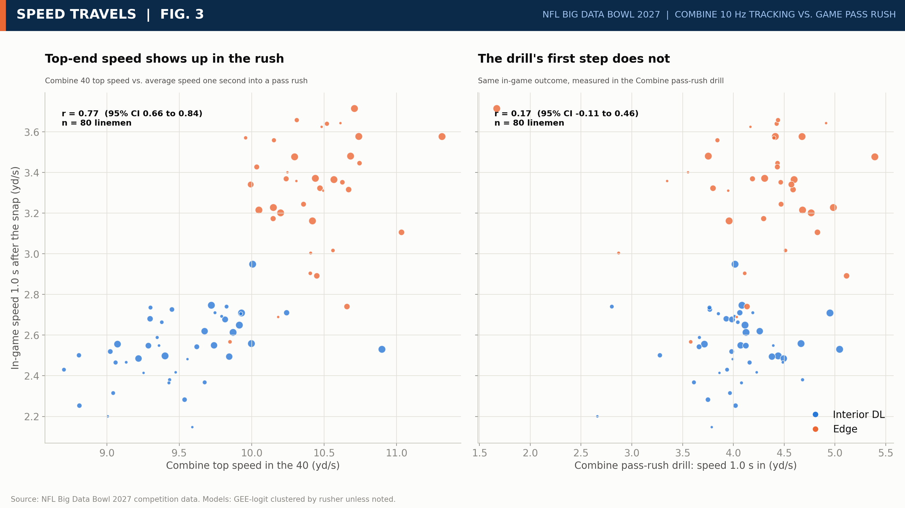
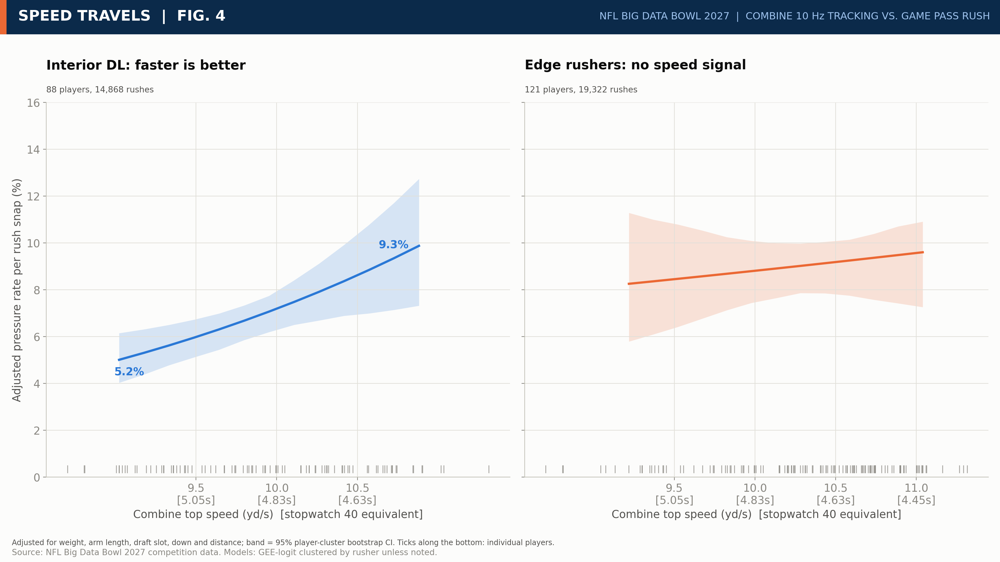
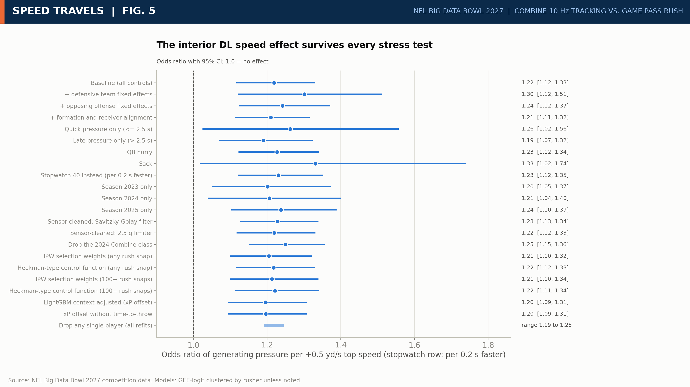
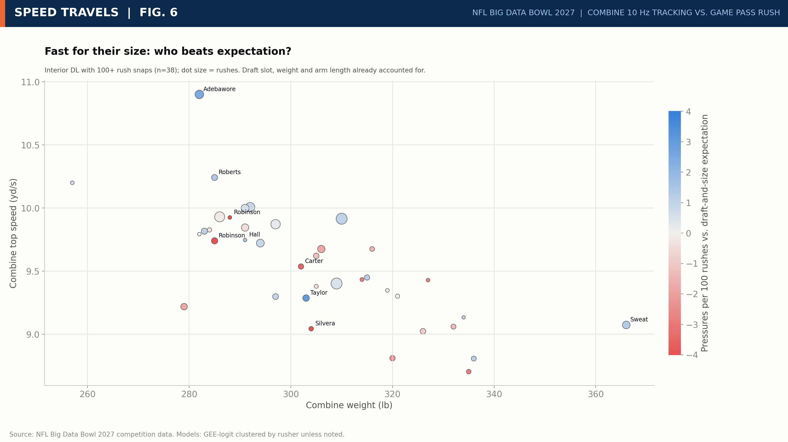
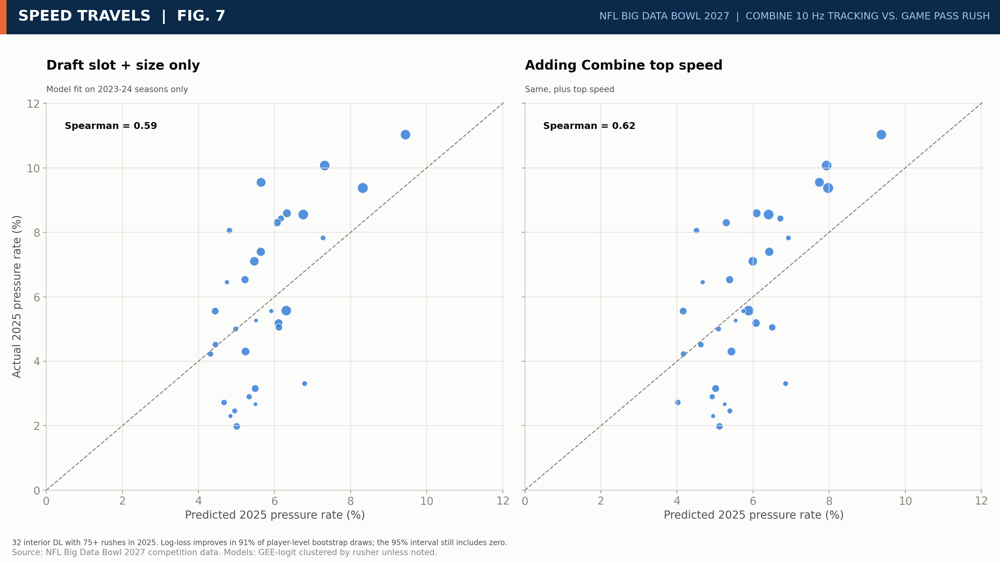

# Speed Travels: What 10 Hz Combine Tracking Tells Us About the NFL Pass Rush

Entry for the Kaggle **NFL Big Data Bowl 2027** (Open track) by Doğukan Turan.

- Kaggle writeup: https://www.kaggle.com/competitions/nfl-big-data-bowl-2027/writeups/speed-travels-nfl-pass-rush
- Kaggle notebook (rebuilds every number and figure from the competition files): https://www.kaggle.com/code/doukanturan/nfl-bdb27-speed-travels

## One-paragraph summary

At 10 Hz the 40-yard dash is a top-speed test (tracking peak speed vs stopwatch time: r = -0.98). For **interior defensive linemen** (88 players, 14,868 rushes) each +0.5 yd/s of Combine top speed raises the odds of generating pressure by 22% (OR 1.22, 95% CI 1.12 to 1.33). Moving from the 10th to the 90th percentile of speed moves the adjusted pressure rate from 5.2% to 9.3%. The effect survives sensor cleaning (Savitzky-Golay and a 2.5 g limiter), inverse-probability weighting and a Heckman-type control function for selection into the NFL, a LightGBM expected-pressure (xP) context model (POE OR 1.20), and Beta-Binomial hierarchical shrinkage (OR 1.20, LR p = 0.009). Formal Imai-Keele-Tingley mediation puts 18% (5% to 42%) of the effect through a faster get-off. **Edge rushers, offensive linemen and WR/TE show no detectable speed effect**; on the edge, speed does reach the field but is spent on less direct paths (inconsistent mediation). Drill "first-step" numbers have reliability of 0.36 to 0.54 and do not travel to games.

## Headline table

| Group | Outcome | Players / snaps | Effect of +0.5 yd/s top speed (95% CI) | p |
|---|---|---|---|---|
| Interior DL | Pressure per rush | 88 / 14,868 | OR 1.22 [1.12, 1.33] | <0.001 |
| Edge | Pressure per rush | 121 / 19,322 | OR 1.05 [0.96, 1.14] | 0.30 |
| OL (T, G, C) | Pressure allowed per block | 94 / 48,404 | OR 1.03 [0.93, 1.14] | 0.58 |
| WR / TE | Separation at pass forward (yd) | 123 / 35,252 | +0.008 [-0.052, +0.067] | 0.80 |
| WR / TE, deep | Separation at pass forward (yd) | 122 / 13,020 | +0.016 [-0.060, +0.092] | 0.68 |

112 tests in total (15 headline, 76 mechanism, 21 robustness); 66 have Benjamini-Hochberg q < 0.05. Every interior headline test has q < 0.001 except the Beta-Binomial test (q = 0.017). No edge, OL or WR headline test has q below 0.4.

## Figures

| | |
|---|---|
|  Fig. 1: Rebuilt 40-yard dash from 10 Hz tracking |  Fig. 2: Reliability of Combine metrics (40 vs drill) |
|  Fig. 3: Does Combine speed translate to in-game speed? |  Fig. 4: Pressure rate vs Combine top speed (interior DL vs edge) |
|  Fig. 5: Robustness checks (sensor, selection, xP, seasons) |  Fig. 6: Scouting view, interior DL vs expectation |
|  Fig. 7: Out-of-time check (fit through 2024, test 2025) | |

## Methods in the notebook

1. **Combine features from raw 10 Hz traces**: start of motion, peak speed over 30 yd, speed at 10 yd, 10 to 30 yd split, acceleration time constant; test-retest reliability from repeat attempts.
2. **Sensor audit**: all 793 forty-yard attempts (2023 to 2025) scanned for frames above 3.5 g; none found in the 40-yard window. Features rebuilt with a Savitzky-Golay derivative filter and a 2.5 g slew limiter as a check.
3. **Outcomes from game tracking**: pressure per pass rush (interior DL, edge), pressure allowed per block (OL), route- and coverage-adjusted separation at pass-forward (WR/TE).
4. **Main model**: logistic GEE on snaps with standard errors clustered by player; controls for weight, arm length, log draft slot, down and distance. Cluster bootstrap, permutation test, leave-one-player-out, team and opponent fixed effects, alternative outcome definitions, per-season fits.
5. **Selection**: cross-fitted logistic selection model over all 510 prospects (AUC 0.97 / 0.99), inverse-probability-weighted GEE, Heckman-type control function with draft class as the excluded variable.
6. **Context model**: LightGBM expected pressure (xP) on 34,190 rushes with GroupKFold by rusher (and by game as a check); Pressure Over Expected; GEE with logit(xP) offset; Beta-Binomial empirical-Bayes shrinkage of player POE.
7. **Mediation**: Imai-Keele-Tingley quasi-Bayesian mediation (1,000 draws, cluster-robust covariances) on the risk-difference scale; mediators are get-off, speed at 1 s, path efficiency, depth and width over the first 2 s.
8. **Multiple testing**: Benjamini-Hochberg FDR over all 112 tests, by family.
9. **Out-of-time check**: fit through 2024, test on 2025.
10. **Decision matrix**: 10 to 30 yd split cuts, weight bands, and edge path-efficiency cells with POE and bootstrap intervals.

## Repository layout

```
notebook/   speed-travels.ipynb (the Kaggle notebook), speed_travels.py (same code as a script), kernel-metadata.json
writeup/    writeup.md (the submitted text, about 1,940 words), EMBED_FIGURES.md
figures/    fig1 to fig7, 16:9 at 3200x1800
results/    results.json (every number quoted in the writeup), table1.csv
```

## Reproducing

The competition data is only available inside Kaggle. Attach the `nfl-big-data-bowl-2027` competition dataset and run `notebook/speed-travels.ipynb` on a CPU kernel (no internet needed); it writes `results.json`, `table1.csv` and the seven figures. Or push it with the Kaggle CLI:

```
kaggle kernels push -p notebook
```

Python packages used: pandas, numpy, pyarrow, scipy, statsmodels, scikit-learn, lightgbm, matplotlib.

## Limitations (stated in the writeup)

Observational data; 88 interior and 121 edge players; the sensor audit covers the 40-yard window only; no quarterback tracking, time to throw or line-up depth, so double-team and alignment are proxies; edge and OL nulls mean no detectable linear speed effect, not zero.

## License

Code: MIT. Competition data belongs to the NFL and Kaggle and is not included here.
