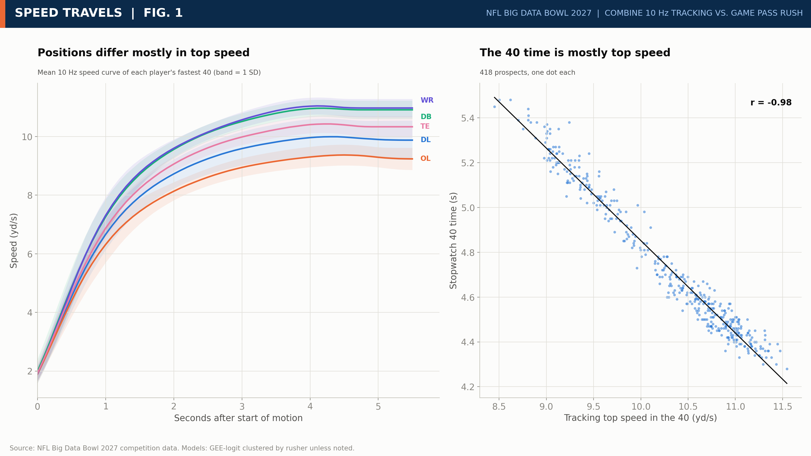
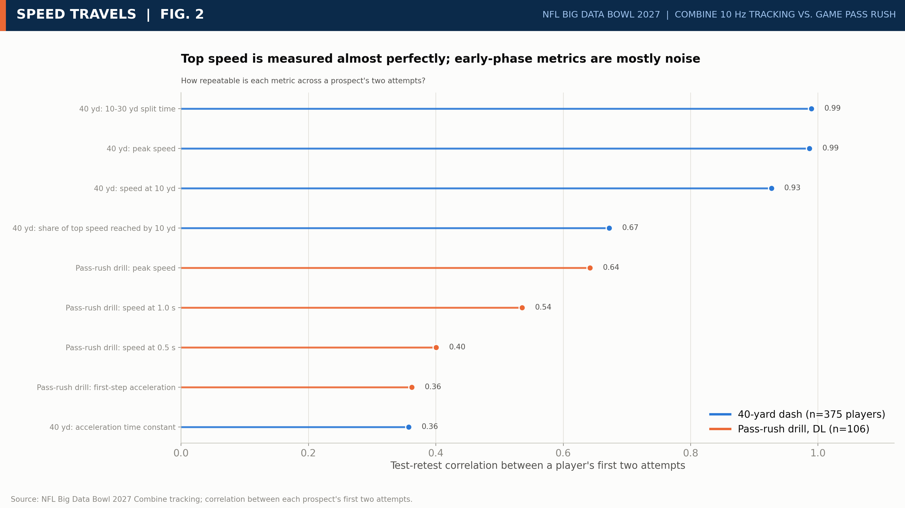
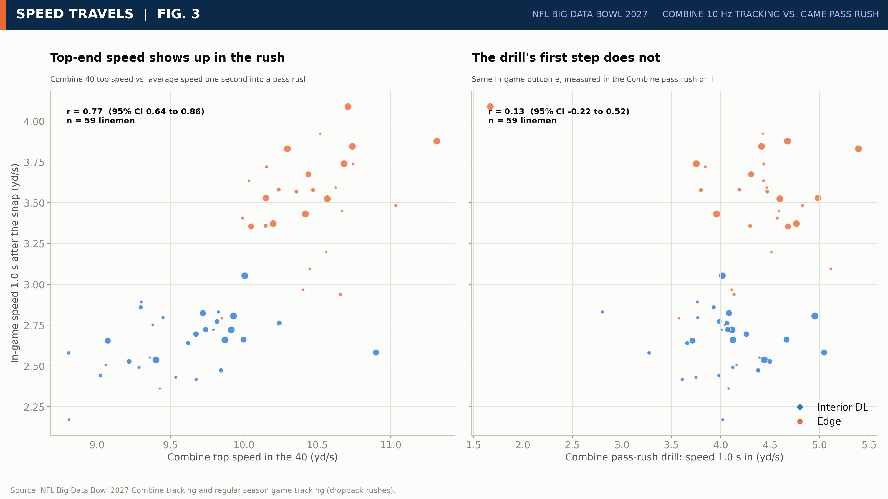
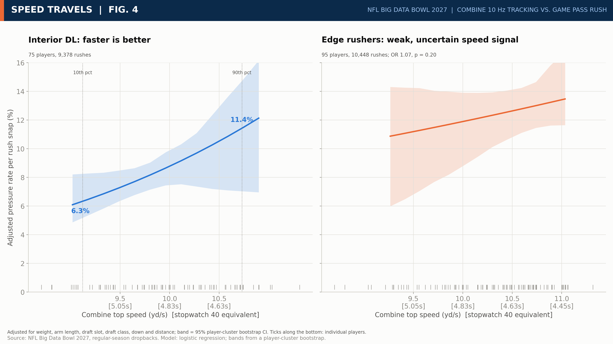
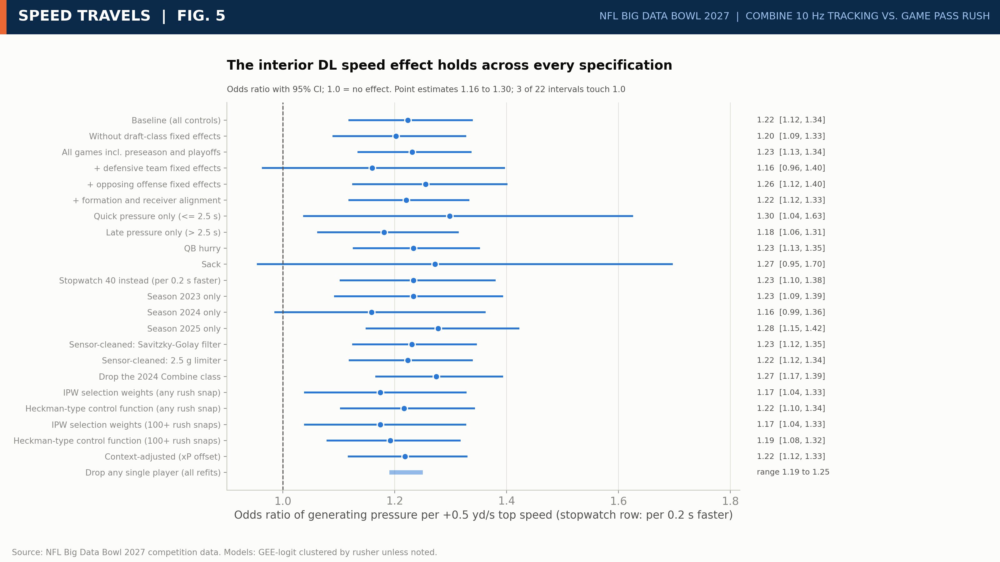
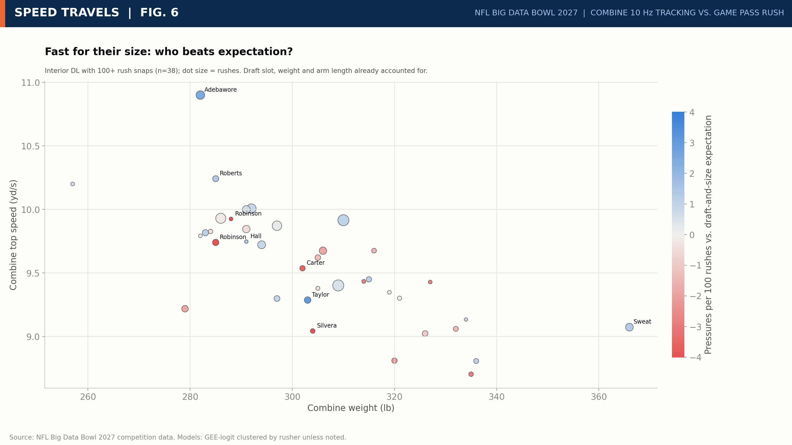
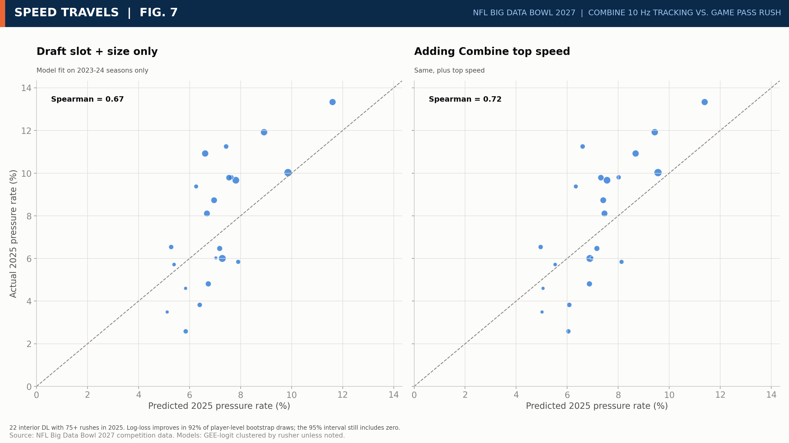

# Speed Travels: What 10 Hz Combine Tracking Tells Us About the NFL Pass Rush

**Track:** Open. The attached public notebook rebuilds every number and figure from the raw competition files; code, figures and results are mirrored at github.com/tdogukan470-jpg/nfl-bdb-2027.

**Bottom line for a front office.** (1) The 40's top speed is the one Combine movement number that reaches the field: it repeats almost perfectly and shows up in game speed, while drill first-step numbers are noise. (2) Faster interior linemen get off the ball sooner (robust to resampling whole players) and generate more pressure (6.3% to 11.4% from the 10th to 90th speed percentile); the pressure gain is precise only in the 2023 class, so use it as a tiebreaker, not a rule. (3) For edge rushers, offensive linemen and receivers the 40 adds nothing detectable beyond size and draft slot.

## 1. The question

Which Combine movement traits carry over to regular-season NFL performance, and which do not?

Published studies find weak links between Combine tests and season production: sprint times mattered only for running backs in one [1], the tests explained about 3% of first-year performance in another [2], and correlations were scattered in others [3, 4]. Season totals mix talent with opportunity. We use per-snap outcomes from game tracking, movement rebuilt from the 10 Hz trace, one position group at a time, with size and draft slot held fixed.

## 2. What the Combine data measures, and whether we can trust it

From each 10 Hz 40-yard trace we rebuilt start of motion, peak speed over 30 yd, speed at 10 yd, the 10 to 30 yd split and an acceleration time constant (Fig. 1). The stopwatch 40 is almost entirely top-end speed: across 418 prospects, tracking peak speed and stopwatch time correlate at r = -0.98.

*Figure 1. Left: mean speed curve of each player's fastest tracked 40 by position group (band = 1 SD). Right: tracking top speed against the stopwatch 40 time, one dot per prospect.*

**Reliability (Fig. 2).** Across repeat attempts, peak speed (0.99) and the 10 to 30 yd split (0.99) are nearly perfectly repeatable; the acceleration constant is 0.36. In the pass-rush drill, speed at 1.0 s is 0.54, at 0.5 s 0.40, first-step acceleration 0.36.

*Figure 2. Test-retest reliability from repeat attempts (375 players with two 40s, 106 with two drill reps). Top speed repeats; first-step metrics do not.*

**Sensor audit.** No frame in any of the 793 forty-yard attempts (2023 to 2025) exceeds 3.5 g (median peak 0.5 g), so quantization spikes do not drive the feature; rebuilding top speed with a Savitzky-Golay filter [9] or a 2.5 g limiter leaves it (r = 0.999) and the interior result (OR 1.23 and 1.22) unchanged. Public notebooks report [11] (not verified by us) that 2023-24 positions sit on a 1/60-yd grid while 2025 is full precision, so every model carries draft-class fixed effects; the 2025 and 2023 classes give similar point estimates (1.24 and 1.27; Section 9).

**Data hygiene.** We drop preseason and playoff games (21% of player-play rows) and keep regular-season dropbacks; including every game gives OR 1.23.

## 3. Drill numbers do not travel (Fig. 3)

For 59 linemen with both drill traces and game tracking, the 40's top speed tracks game speed one second after the snap within each group (interior r = 0.39, edge r = 0.37; pooled 0.77, inflated by the interior-edge gap). The drill's speed one second in does not (r = 0.13, CI -0.22 to 0.52); its peak speed does better (r = 0.47; top speed again). Trust the 40's speed trace; single-attempt first-step numbers are too noisy to use alone.

*Figure 3. Combine measures against in-game speed one second after the snap: the 40's top speed (left) carries over, the pass-rush drill's speed 1.0 s in (right) does not. Dot size: game rushes.*

## 4. Method

From 2023 to 2025 regular-season tracking we computed pressure per pass rush (interior DL, edge), pressure allowed per block (OL) and separation at pass-forward for WR/TE adjusted for route and coverage. The Combine feature is mean top speed across a player's 40 attempts, in units of +0.5 yd/s, about 0.2 s on the stopwatch at a lineman's speed. Models are GEE with standard errors clustered by player [8] (logistic for pressure, linear for separation), controlling for weight, arm length, log draft slot and draft class, plus down and distance for rushers and route, coverage and cushion for receivers. Speed and weight correlate at -0.83 among interior linemen, so size is always in the model. An odds ratio (OR) of 1.22 means 22% higher odds of pressure; 1.0 means no effect.

## 5. Result: interior defensive linemen

For 75 interior DL and 9,378 rushes, each +0.5 yd/s raises the odds of pressure by 22% (OR 1.22, 95% CI 1.12 to 1.34; resampling whole players, 0.99 to 1.42). From the 10th to the 90th percentile of speed (9.1 to 10.7 yd/s) the adjusted pressure rate moves from 6.3% to 11.4%, a ratio of 1.8 (CI 1.1 to 2.8; Fig. 4). In scouting terms: for two interior prospects of the same size and draft range, 0.2 s on the 40 is worth about 1.4 pressures per 100 rushes.

**Table 1. Effect of +0.5 yd/s Combine top speed.** *Interior = lined up inside on the snap; 19 of the 75 are linebackers or defensive backs (3% of rushes). Roster DT, NT or DE only: OR 1.25 [1.15, 1.36], 56 players. Interior row with whole players resampled: 0.99 to 1.42.*

| Group | Outcome | Players / snaps | Effect (95% CI) | p |
|---|---|---|---|---|
| Interior DL | Pressure per rush | 75 / 9,378 | OR 1.22 [1.12, 1.34] | <0.001 |
| Edge | Pressure per rush | 95 / 10,448 | OR 1.07 [0.96, 1.19] | 0.20 |
| OL | Pressure allowed | 72 / 38,854 | OR 1.02 [0.92, 1.14] | 0.67 |
| WR / TE | Separation (yd) | 102 / 29,670 | -0.011 [-0.071, +0.049] | 0.72 |
| WR / TE, deep | Separation (yd) | 100 / 10,978 | -0.008 [-0.089, +0.073] | 0.85 |

*Figure 4. Adjusted pressure rate against Combine top speed with cluster-bootstrap bands. Interior linemen rise across the speed range; the edge slope is weak and its interval includes zero.*

**Stress tests (Fig. 5).** Across 22 alternative specifications the odds ratio runs from 1.16 to 1.30. Only team fixed effects, sacks and the 2024 season alone have intervals touching 1.0. Dropping any single player gives 1.19 to 1.25; a permutation test gives p < 0.001. Single seasons share draft classes, so they are not independent checks.

*Figure 5. The interior effect under every specification: fixed effects, outcome definitions, seasons, sensor cleaning, selection correction and the context model, with clustered-SE intervals; the orange bar resamples whole players. 1.0 is no effect.*

**Top speed, not burst.** Top speed carries the effect (OR 1.21) and burst carries none (OR 1.03, p = 0.54); the stopwatch 10-yard split adds nothing once the 40 is in (p = 0.35).

## 6. Are we only seeing the players good enough to play?

A fast lineman who never earns snaps is invisible here, which could flatter speed. Of 510 prospects, 79% appear in game tracking, but only 105 (21%) rush the passer and 48 (9%) rush 100+ times. Upweighting rushers whose profile made the field unlikely (stabilized inverse-probability weights; with AUC 0.96 the weights lean on few players) gives OR 1.17 (1.04 to 1.33), the same for 100+ rushes. A Heckman-type control function [7], with draft class as the excluded variable, gives 1.22 and 1.19 (Mills ratio p = 0.16 and 0.63). Correcting for who reached the field shrinks the estimate slightly but does not remove it.

## 7. Is it the player or the situation?

Some rushes are easier than others. We predicted each rush's pressure chance (xP) on 19,826 dropback rushes from game situation, formation and the distance to the nearest opposing lineman (a double-team proxy). Out of fold (folds grouped by rusher) a ridge logistic regression narrowly beat a regularized LightGBM [10], but context predicts pressure only weakly (AUC 0.58; log loss improves 1.1% over the league rate), so POE stays close to the raw rate.

Pressure Over Expected (POE) is pressure minus xP: what the rusher adds beyond his situation. Adjusting for situation changes nothing: interior OR 1.22 (1.12 to 1.33), or 1.4 POE points per 100 rushes per +0.5 yd/s (0.8 to 2.0). Edge: OR 1.05 (0.94 to 1.18).

**Can we rank individual players? No.** A Beta-Binomial model that pulls each player's POE toward what his measurables predict cuts the spread of player POE from 13.2 to 1.6 points; at 500 rushes a player's own record gets 3% weight. Speed in that model carries OR 1.20 (likelihood-ratio p = 0.003, but player bootstrap 0.93 to 1.34): supportive, not decisive. Edge: OR 1.04 (0.86 to 1.24).

## 8. How does speed become pressure?

We split the speed effect into paths (Imai-Keele-Tingley mediation [5], 1,000 draws); units are pressures per 100 rushes per +0.5 yd/s.

**Interior: a faster first move.** Speed shortens get-off (snap to first movement) by 0.14 SD per +0.5 yd/s (whole-player bootstrap 0.08 to 0.21; shorter in all three classes, each imprecise alone), and get-off drives pressure: the part running through it (indirect effect) is +0.29 [0.15, 0.45] (p = 0.001) of a total +1.46 [0.81, 2.13], so **20% (9% to 43%) runs through get-off**. No other path carries a detectable share.

**Edge: the path spends the speed.** Faster edge rushers do run faster in-game (indirect effect through speed at 1 s +0.69 [0.32, 1.08]), but they take less direct paths: path efficiency carries -0.41 [-0.86, -0.13] against a direct effect of +1.22 [0.14, 2.40], total +0.79 [-0.40, 1.98]. These assume no unmeasured factor drives both path and outcome.

## 9. Does it predict players we have not seen?

The easier test: fit through 2024, predict 2025 (Fig. 7). For 22 interior linemen with 75+ snaps, adding speed lifts the rank correlation from 0.67 to 0.72; the log-loss gain is positive in 92% of bootstrap resamples but its interval includes zero. The harder test fails: hiding one whole draft class at a time, adding speed does not improve predictions for the hidden class (log-loss gain -0.48 x 10^-3, 95% CI -1.26 to +0.40; rank correlation 0.32 without speed, 0.25 with). Per class (Fig. 6) the estimate exceeds 1 (2023 1.27, 2024 1.11, 2025 1.24; class difference p = 0.38), but only 2023 is precise; without 2023, OR 1.09 [0.75, 1.57]. The data cannot separate a common effect from a 2023-only one.

*Figure 6. Interior speed effect fit separately by draft class. Blue: clustered-SE intervals; orange: whole-player bootstrap. Every class leans positive; only 2023 is precise.*

*Figure 7. Models fit on 2023 and 2024 predict 2025 interior pressure rates; most 2025 rates sit above the predictions. Adding Combine speed lifts the rank correlation from 0.67 to 0.72; the change has a 95% interval of -0.11 to 0.23.*

**Luck across many tests.** Of 114 tests, 62 keep q < 0.05 after Benjamini-Hochberg correction [6] (q is the p-value adjusted for the number of tests). Every interior headline test (Table 1, top speed, stopwatch 40, POE) has q at or below 0.002 except the Beta-Binomial likelihood-ratio test (q = 0.007; its player bootstrap interval includes 1); no edge, OL or WR headline test has q below 0.2.

## 10. How a team uses this

**Table 2. Draft-cycle and deployment decision matrix. POE is percentage points of pressure per 100 rushes above context expectation.**

| Prospect profile | Evidence | Action |
|---|---|---|
| Interior, 10 to 30 yd split <= 2.12 s (37 players) | POE +1.7 [+0.3, +3.2] vs -0.5 for the rest; gap +2.3 [+0.5, +4.1] | Flag for a closer pass-rush look |
| Interior, split 2.12 to 2.20 s (15 players) | POE -0.2 [-2.4, +1.1] | Rely on tape and size |
| Interior, split > 2.20 s (23 players) | POE -0.9 [-1.9, +0.1] | Lower pass-rush priority; let tape decide |
| Interior up to 294 lb (3-tech types) | Fast-minus-slow POE +2.3 [-4.3, +11.9] (<= 263 lb) and +3.1 [+0.6, +5.3] (264 to 294 lb) | Weigh the split here; the 264 to 294 lb gap excludes 0 |
| Interior 297+ lb (nose types) | Fast-minus-slow +0.5 [-2.4, +2.4] | No gap; use other traits |
| Fast edge, efficient drill path (16 players) | POE +1.5 [-1.8, +3.3] | No clear gain from speed; judge on tape |
| Fast edge, inefficient drill path (18 players) | POE -0.8 [-3.8, +0.5]; wide -1.2, tight -1.7 (exploratory) | Wider alignment did not help |
| Slow edge, efficient / inefficient path (18 / 15 players) | POE -2.2 [-4.4, -0.4] and -3.0 [-6.2, +0.2] | Below the fast cells; edge speed may help a little (OR CI includes 1) |
| OL, WR/TE | No detectable speed effect | Do not pay for speed alone |

Edge cells use the drill's path efficiency, which does not predict pressure on its own (interaction p = 0.54), so judge path directness on tape. Weight bands proxy 3-tech versus nose. The split cut-off was chosen from 7 scanned values (2.01 to 2.27 s); only 2.12 s gives a fast-minus-slow gap whose interval excludes 0, so the interior rows are exploratory.

## 11. Limitations

- Observational data: no causal claim beyond the mediation assumptions above.
- 75 interior and 95 edge players; decision-matrix cells are small.
- Only the 2023 class estimates the pressure effect precisely.
- The sensor audit covers the 40-yard window only; no quarterback tracking, time to throw or line-up depth, so double-team and alignment are proxies.
- Edge and OL nulls mean no detectable linear speed effect, not zero.

## 12. Takeaway

At 10 Hz the 40 is a top-speed test, and its clearest game footprint is a faster interior get-off. The pressure gain that follows (about 1.8x from slow to fast) is not yet proven out of class, so it should guide where scouts look, not replace the tape. On the edge, speed is real but the path spends it.

## Appendix: references

1. Kuzmits FE, Adams AJ. The NFL combine: does it predict performance in the National Football League? J Strength Cond Res. 2008;22(6):1721-1727. doi:10.1519/JSC.0b013e318185f09d
2. Cook J, Ryan GA, Snarr RL, Rossi S. The relationship between the NFL Scouting Combine and game performance over a 5-year period. J Strength Cond Res. 2020;34(9):2492-2499.
3. LaPlaca DA, McCullick BA. National Football League Scouting Combine tests correlated to National Football League player performance. J Strength Cond Res. 2020;34(5):1317-1329. doi:10.1519/JSC.0000000000003479
4. Vincent LM, Blissmer BJ, Hatfield DL. National Scouting Combine scores as performance predictors in the National Football League. J Strength Cond Res. 2019;33(1):104-111. doi:10.1519/JSC.0000000000002937
5. Imai K, Keele L, Tingley D. A general approach to causal mediation analysis. Psychol Methods. 2010;15(4):309-334.
6. Benjamini Y, Hochberg Y. Controlling the false discovery rate: a practical and powerful approach to multiple testing. J R Stat Soc B. 1995;57(1):289-300.
7. Heckman JJ. Sample selection bias as a specification error. Econometrica. 1979;47(1):153-161.
8. Liang KY, Zeger SL. Longitudinal data analysis using generalized linear models. Biometrika. 1986;73(1):13-22.
9. Savitzky A, Golay MJE. Smoothing and differentiation of data by simplified least squares procedures. Anal Chem. 1964;36(8):1627-1639.
10. Ke G, et al. LightGBM: a highly efficient gradient boosting decision tree. Advances in Neural Information Processing Systems 30. 2017.
11. Data notes on preseason games, ball frames and the 2025 export come from the competition data page and public BDB 2027 notebooks by D. Afshar ("Combine Tracking Audit") and Yumeko ("DB Drills Decoded"), Kaggle, October 2026.

References 1-4 are cited from their abstracts and library records, not full texts.
